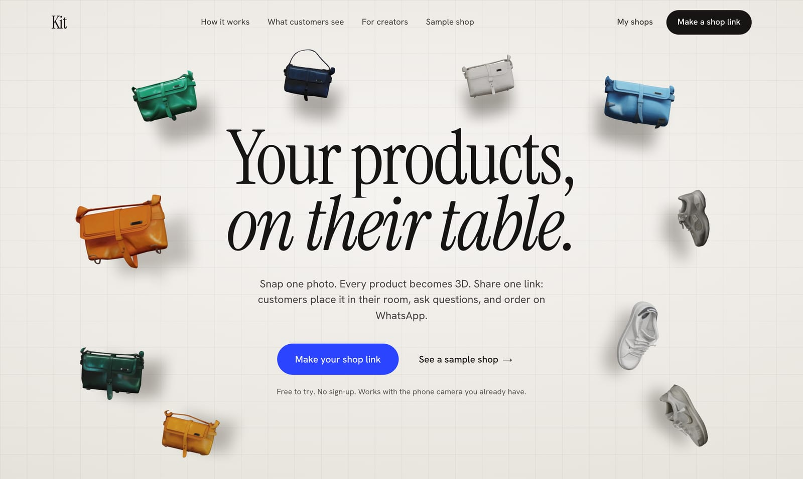
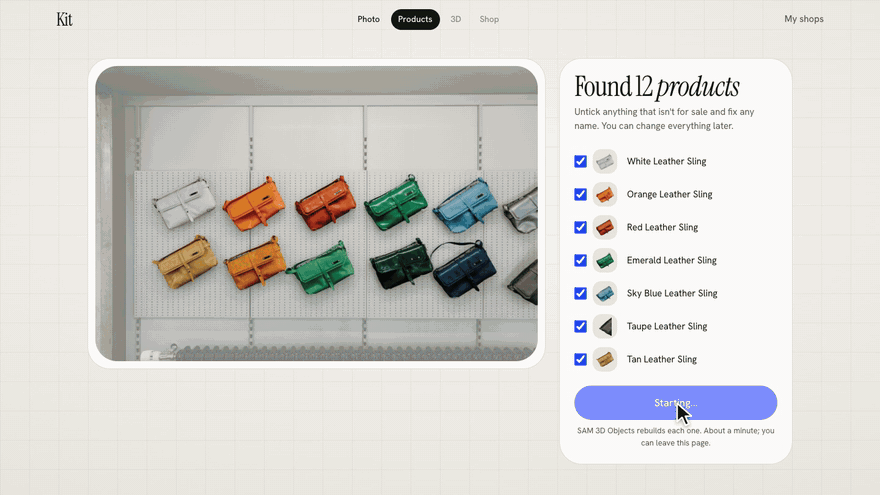
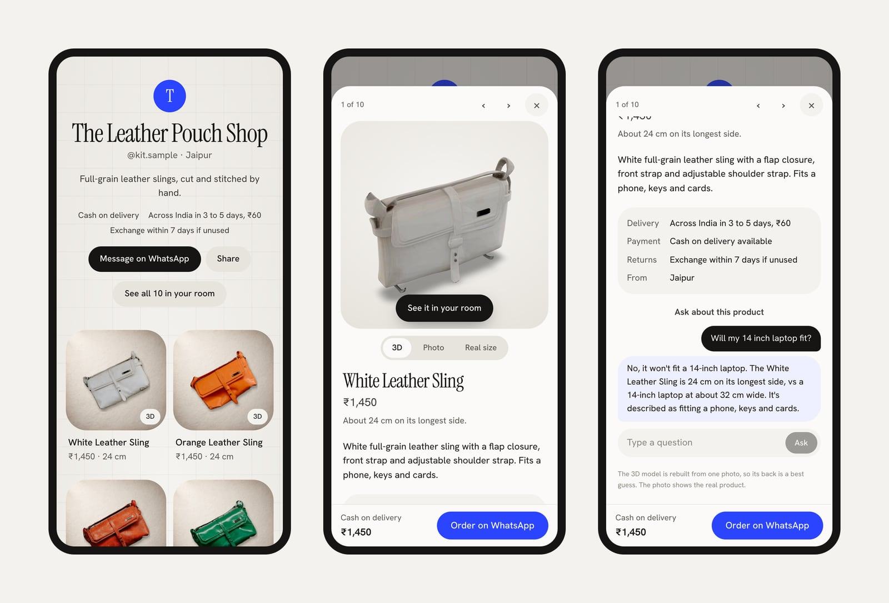
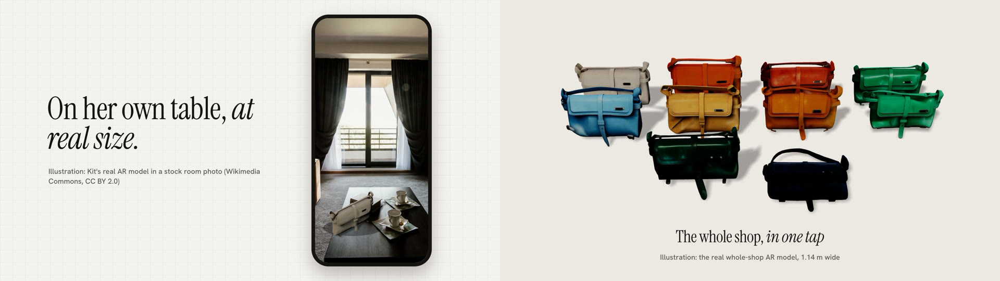
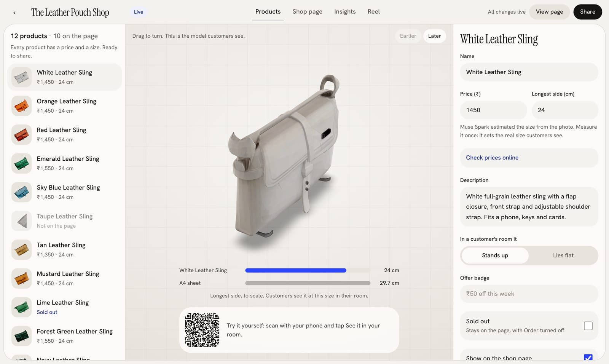
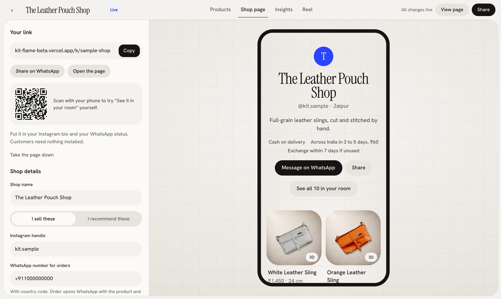

<h1 align="center">Kit</h1>

<p align="center"><b>One photo of your products becomes a shop where every product is real-size 3D.<br>Customers place it on their own table, ask questions, and order on WhatsApp.</b></p>

<p align="center">
  <a href="https://kit-flame-beta.vercel.app/k/sample-shop"><b>Try the sample shop on your phone</b></a>
  &nbsp;·&nbsp;
  <a href="https://kit-flame-beta.vercel.app/new"><b>Make your own (free, no sign-up)</b></a>
  &nbsp;·&nbsp;
  <a href="https://kit-flame-beta.vercel.app"><b>kit-flame-beta.vercel.app</b></a>
</p>

<a href="https://kit-flame-beta.vercel.app"></a>

## The problem

Small sellers on Instagram and WhatsApp answer the same questions on every post: what size is it, will my laptop fit, can you show the back, do you do cash on delivery. A flat photo can't answer any of them, and a studio 3D model costs thousands of rupees per product. By the time the seller replies, most buyers have bought somewhere else.

## One photo in, every product in 3D

The seller takes one photo of the shelf. Muse Spark Open finds every product, SAM 3.1 cuts each one out, and SAM 3D Objects rebuilds them all at once, about two minutes for a dozen products at about 2 US cents each.



## What the customer sees

On the shop link: every product in 3D to turn and zoom, its real size next to an A4 sheet, **See it in your room**, answers from the seller's own measurements, and delivery, cash on delivery and returns right next to **Order on WhatsApp**.



**See it in your room** places the product at its real size through the phone camera, with no app. **See all in your room** places the whole shop at once, in rows on the floor.



<sub>Illustration: Kit's real AR models rendered into a stock room photo (Wikimedia Commons, CC BY 2.0) and onto a plain floor. On a phone, Kit opens them in AR Quick Look (iPhone) or Scene Viewer (Android).</sub>

## What the seller gets



1. **One photo in.** Lay the products out and take one picture. Already on Shopify? Paste the store address instead.
2. **Every product in 3D,** found, cut out and rebuilt as a textured model.
3. **Details filled in.** A name, a short description and an estimated real size for each product, to check; Muse Spark also decides whether it stands up or lies flat in a room. An optional price check searches Indian shops and shows a range with its sources.
4. **Buyer details.** City, delivery time and cost, cash on delivery, returns, and a Sold out switch per product.
5. **One link out** (`/k/your-shop`) for the Instagram bio, WhatsApp status and customer groups, plus a private edit link to send to their own WhatsApp. No accounts.
6. **A Shop Manager.** A morning report from the shop's own numbers and customer questions, with suggested changes that apply only after the seller taps Approve.



## Works with what sellers already use

| Where | How |
|---|---|
| WhatsApp, Instagram, Facebook | Every shop is a product catalog feed (`/api/k/:slug/catalog.csv`) in Meta's format. Added once in Commerce Manager, the products appear in the seller's WhatsApp Business catalog, on Instagram and Facebook, and in catalog ads, each linking back to its 3D page. Prices, sold out and new products follow on their own. |
| Shopify | Paste a store address. Kit reads the store's public product list and builds each product in 3D, keeping its real name, price, description and product link. No app to install. |
| Any store (Shopify, WooCommerce, Dukaan) | One line of code puts a product's 3D view on its product page, with See it in your room. |

## Meta models, and what each one does

| Model | Where it runs | What it does in Kit |
|---|---|---|
| Muse Spark Open | Meta open weights, on Baseten | Lists every product in the photo |
| SAM 3.1 | Meta Model API | Cuts out each listed product (box prompts, many objects per call) |
| SAM 3D Objects | Meta open weights, served via fal | Rebuilds each cut-out as a textured 3D model |
| Muse Spark | Meta Model API | Names, describes and sizes each product and says whether the photo was taken from above or the front (so AR lays it flat or stands it up); picks each product's catalog category; price check with web search and cited sources |
| Muse Wonder | Meta Model API | The shop assistant customers ask, and the Shop Manager agent that writes reports and proposes changes |
| Muse Image | Meta Model API | One empty backdrop per shop; product photos place the real cut-out on it, so the product is never redrawn |

## Measured

From the `api_spend` and `jobs` tables, not estimates:

- **A dozen products in about two minutes.** A real Shopify store import (12 products, 16 pieces found): listing 7 s, finding and cutting out 33 s in all, all 16 models rebuilt in parallel in 71 s.
- **About 2 US cents per product.** That import cost $0.36 in model calls; SAM 3D Objects is $0.02 a product. The 196 models built so far cost $2.97 in total across every model.
- A customer question costs about 1 cent; a Shop Manager report about 3 cents. Both are capped per shop per day.

## How real-size AR works

- The 3D model from one photo has no scale. Kit scales an AR copy so its longest side is the size the seller confirmed, rests it on the floor, and turns it to lie flat or stand up.
- Android and WebXR get plain glTF in metres. iPhone gets a USDZ written on the server from the same model (uncompressed, 64-byte aligned, metres, Y up), checked with OpenUSD's validators. Letting the browser convert on the tap left iPhones in Object mode with AR greyed out.
- The whole shop is one merged model, laid out in rows of four, 6 cm apart.
- Instagram's and WhatsApp's in-app browsers can't open AR, so the button copies the link and says to open it in Safari or Chrome instead of failing silently.

## Honest limits

- One photo shows one side of each product. The back of every 3D model is a best guess, so the page calls it a 3D preview and keeps the real photo alongside.
- Sizes are estimated from the photo until the seller confirms them. AR size and fit answers use only the size on the page.
- Cloth, thin straps, glass and shiny metal rebuild less well than solid products.
- Shopify import uses the first photo of each product. A product shown as a set of pieces (a soundbar with speakers) keeps its largest piece.
- The catalog feed passes every rule in Meta's published catalog reference (`pnpm check:catalog`), but has not yet been loaded into a live Commerce Manager account.
- Price ranges come from live web search and change between searches. They appear only with at least two sources, and the seller always sets the price.

## Tests and checks

```bash
pnpm typecheck && pnpm lint
pnpm test:budget         # spend caps, retries, per-job limits (no network, no spend)
pnpm test:integrations   # store addresses, Shopify matching, CSV, categories, USDZ packaging (no network, no spend)
pnpm check:catalog https://kit-flame-beta.vercel.app/api/k/sample-shop/catalog.csv
```

## Tech

Next.js (App Router, TypeScript strict) · react-three-fiber · `<model-viewer>` · gltf-transform · sharp · Supabase (Postgres, Storage, Realtime) · Vercel. See [`docs/architecture.md`](docs/architecture.md) for the pipeline, data model and cost controls.

## Getting started

```bash
cp .env.example .env.local   # fill in keys
pnpm install
pnpm dev
```

Built from October 27 to November 4, 2026.

## License

MIT
